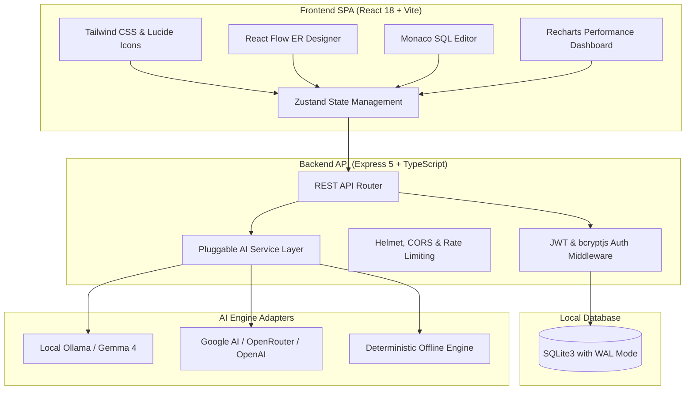

# ⚡ Intelligent DBMS Studio

[](LICENSE)
[](https://www.typescriptlang.org/)
[](https://reactjs.org/)
[](https://vitejs.dev/)
[](https://nodejs.org/)
[](https://sqlite.org/)

**Intelligent DBMS Studio** is a full-stack, AI-powered database development platform that unifies visual ER diagramming, Monaco SQL IDE, AI query generation & optimization, database schema health analysis, and simulated execution performance monitoring.

---

## 🏛️ System Architecture



---

## 🌟 Key Features

1. **Visual ER Database Designer**
   - Interactive drag-and-drop schema canvas powered by **React Flow**
   - Add and configure tables, data types, Primary Keys, Unique constraints, Nullability, and Auto-increment
   - Connect tables to create foreign key relationships (`One-to-One`, `One-to-Many`, `Many-to-Many`) with `ON DELETE` / `ON UPDATE` cascades
   - Multi-dialect DDL generation and schema export supporting **MySQL**, **PostgreSQL**, and **SQLite**

2. **AI SQL Generator**
   - Natural Language to SQL translation
   - Context-aware querying referencing active project schemas
   - Returns executable SQL, human-friendly clause explanations, referenced tables, assumptions, and query performance tips

3. **AI Database Copilot**
   - Floating AI assistant drawer accessible across every page
   - Context-aware database chat, quick prompts, and real-time SQL suggestions

4. **Monaco SQL IDE**
   - Full VS Code Monaco SQL Editor with syntax highlighting, autocomplete, and query preloading
   - Safe simulated query execution sandbox with data tables and execution metrics
   - One-click SQL query formatter and AI clause breakdown explainer
   - Query result export to CSV and JSON formats

5. **AI Query Optimizer**
   - Instant SQL anti-pattern detection (Full table scans, correlated subqueries, missing indexes, `SELECT *`)
   - Before/After performance scoring (e.g. `45/100 -> 81/100`)
   - Side-by-side SQL diff and estimated percentage improvement

6. **Schema Health Analyzer**
   - AI evaluation of database design health score (out of 100)
   - Category breakdowns: Structure, Indexing, Naming conventions, Normalization, Relationships, Performance
   - Actionable severity badges (🔴 Critical, 🟡 Warning, 🔵 Info) with one-click automated fixes

7. **Query History & Bulk Management**
   - Searchable and filterable query execution history
   - Filter by source (`IDE Execution`, `AI Generated`, `Manual`) and status (`Success`, `Failed`)
   - One-click export to CSV and bulk history clearing with confirmation safeguards

8. **Performance Monitor**
   - Live query metrics: Avg execution time, Slow queries, Query volume, Index usage
   - Recharts visual graphs: Execution time curves, Queries per minute, Query type distribution

---

## 🛠️ Technology Stack

| Layer | Technologies |
|---|---|
| **Frontend** | React 18, TypeScript, Tailwind CSS, React Flow (@xyflow/react), Monaco Editor, Recharts, Zustand, Lucide Icons, Vite |
| **Backend** | Node.js, Express 5, TypeScript, TSX, Better-SQLite3, JWT authentication, bcryptjs, Helmet, CORS, Morgan |
| **Database** | SQLite3 with Write-Ahead Logging (`PRAGMA journal_mode = WAL`) and Foreign Keys enabled |
| **AI Layer** | Multi-provider architecture supporting **Google Gemma 4** (local via Ollama), Google Gemini AI, OpenRouter, OpenAI, and built-in offline demo engine |

---

## 🚀 Quick Start Guide

### Prerequisites
- Node.js 18.0.0 or higher
- npm 9.0.0 or higher

### 1. Installation
Clone the repository:
```bash
git clone https://github.com/LEGEND7006/DBMS-Studio.git
cd DBMS-Studio
```

Install backend dependencies:
```bash
cd backend
npm install
```

Install frontend dependencies:
```bash
cd ../frontend
npm install
```

### 2. Environment Configuration
Create environment files from templates:

**Backend** (`backend/.env`):
```env
PORT=5000
JWT_SECRET=your-super-secret-jwt-key
AI_PROVIDER=demo
GEMMA_ENDPOINT=http://localhost:11434
GEMMA_MODEL=gemma4:31b
```

### 3. Run Development Servers
Start backend API:
```bash
cd backend
npm run dev
```
*Backend runs at `http://localhost:5000`*

Start frontend client:
```bash
cd frontend
npm run dev
```
*Frontend runs at `http://localhost:5173` (or `5174`)*

---

## 🔑 Demo Account Credentials

The database automatically seeds a ready-to-use demo account on first startup:
- **Email**: `demo@dbmsstudio.com`
- **Password**: `demo1234`

*(The application also auto-authenticates in demo mode for instant evaluation)*

### Preloaded Schemas
1. **E-Commerce Database** (MySQL): `users`, `categories`, `products`, `orders`, `order_items`, `payments`
2. **Hospital Management System** (PostgreSQL): `patients`, `doctors`, `appointments`, `prescriptions`
3. **College Management System** (PostgreSQL): `students`, `teachers`, `courses`, `enrollments`
4. **Banking Database** (PostgreSQL): `accounts`, `transactions`, `customers`, `loans`

---

## 📚 REST API Reference

All protected endpoints require `Authorization: Bearer <token>`.

### Authentication
| Method | Endpoint | Description |
|---|---|---|
| `POST` | `/api/auth/register` | Register a new user account |
| `POST` | `/api/auth/login` | Authenticate and obtain JWT token |
| `GET` | `/api/auth/me` | Fetch authenticated user profile |

### Projects & Schema Designer
| Method | Endpoint | Description |
|---|---|---|
| `GET` | `/api/projects` | List all projects belonging to user |
| `POST` | `/api/projects` | Create a new project workspace |
| `GET` | `/api/projects/:id` | Get project details |
| `GET` | `/api/projects/:id/schema` | Get full schema (tables, columns, relationships) |
| `PUT` | `/api/projects/:id` | Update project name, description, or db_type |
| `DELETE` | `/api/projects/:id` | Delete project and cascaded schema |
| `POST` | `/api/projects/:id/tables` | Add a new table with columns to project |
| `PUT` | `/api/tables/:id` | Update table name, description, or canvas position |
| `DELETE` | `/api/tables/:id` | Delete table and associated columns |
| `POST` | `/api/tables/:id/columns` | Append column to table |
| `POST` | `/api/relationships` | Create foreign key link between tables |
| `DELETE` | `/api/relationships/:id` | Remove relationship constraint |

### SQL Queries & History
| Method | Endpoint | Description |
|---|---|---|
| `POST` | `/api/queries/execute` | Execute query in simulated sandbox and log history |
| `GET` | `/api/queries/history` | Fetch history (supports `search`, `projectId`, `status`, `limit`) |
| `DELETE` | `/api/queries/history/clear`| Bulk clear query history (all or project-scoped) |
| `DELETE` | `/api/queries/:id` | Delete single query entry from history |

### AI Capabilities
| Method | Endpoint | Description |
|---|---|---|
| `GET` | `/api/ai/config` | Get current AI configuration & status |
| `POST` | `/api/ai/config` | Update provider credentials and settings |
| `POST` | `/api/ai/test-connection` | Test connection to active AI provider |
| `POST` | `/api/ai/generate-sql` | Generate SQL from natural language prompt |
| `POST` | `/api/ai/explain-sql` | Explain SQL statement structure and execution steps |
| `POST` | `/api/ai/optimize-sql` | Detect anti-patterns and suggest optimized SQL |
| `POST` | `/api/ai/analyze-schema` | Analyze project schema and calculate health scores |
| `POST` | `/api/ai/autofix` | Execute automated schema fixes (add PK, index, timestamp) |

---

## 🧪 Testing

The backend includes a comprehensive integration test suite built with Node's native test runner (`node:test` & `node:assert/strict`):

```bash
cd backend
npm test
```

To run TypeScript verification:
```bash
# Backend
cd backend && npm run build

# Frontend
cd frontend && npm run build
```

---

## 🤖 Running Google Gemma 4 Locally

Intelligent DBMS Studio is pre-configured to support local inference via **Google Gemma 4** in Ollama:

```bash
# 1. Pull and run Gemma 4 in Ollama (Flagship reasoning model)
ollama run gemma4:31b

# Or lightweight variants:
# ollama run gemma4:26b   (Mixture-of-Experts)
# ollama run gemma4:12b   (Balanced Workstation)
# ollama run gemma4:e4b   (Ultra-fast Edge)
```

In the app, visit **Settings** to test the connection, toggle Gemma 4 Thinking Mode, or specify a custom remote inference endpoint. When Ollama is not active, the system automatically falls back to the deterministic offline engine.

---

## 🚀 Production Deployment (Vercel + Render)

The project includes pre-configured deployment manifests:
- `render.yaml`: Blueprint configuration for Render backend
- `vercel.json` & `frontend/vercel.json`: SPA routing rewrites for Vercel

---

### Step 1: Deploy Backend to Render

1. Log in to [Render Dashboard](https://dashboard.render.com/).
2. Click **New +** > **Blueprint** (or **Web Service**):
   - **Using Blueprint (Recommended)**: Connect `LEGEND7006/DBMS-Studio`. Render automatically detects `render.yaml` and sets all build/start commands.
   - **Using Web Service**:
     - **Name**: `dbms-studio-backend`
     - **Root Directory**: `backend`
     - **Environment**: `Node`
     - **Build Command**: `npm install && npm run build`
     - **Start Command**: `npm start`
     - **Health Check Path**: `/api/health`
3. Add Environment Variables in Render:
   - `NODE_ENV` = `production`
   - `JWT_SECRET` = `(generate a strong random secret)`
   - `AI_PROVIDER` = `demo` *(or `googleai` / `openrouter`)*
   - `GOOGLE_AI_KEY` = *(optional, your Google AI Studio API key)*
   - `FRONTEND_URL` = *(optional, your Vercel URL; backend also auto-allows all `*.vercel.app` domains)*
4. Click **Deploy**. Note your backend URL (e.g. `https://dbms-studio-backend.onrender.com`).

---

### Step 2: Deploy Frontend to Vercel

1. Log in to [Vercel](https://vercel.com/) and click **Add New... > Project**.
2. Import the `LEGEND7006/DBMS-Studio` repository.
3. Configure the project:
   - **Root Directory**: Click **Edit** and select `frontend` *(or leave default root)*
   - **Framework Preset**: `Vite`
   - **Build Command**: `npm run build`
   - **Output Directory**: `dist`
4. Add Environment Variable:
   - **`VITE_API_URL`**: `https://<YOUR-RENDER-BACKEND>.onrender.com` *(e.g. `https://dbms-studio-backend.onrender.com`)*
5. Click **Deploy**!

---

## 📄 License

This project is licensed under the MIT License — see the [LICENSE](LICENSE) file for details.
